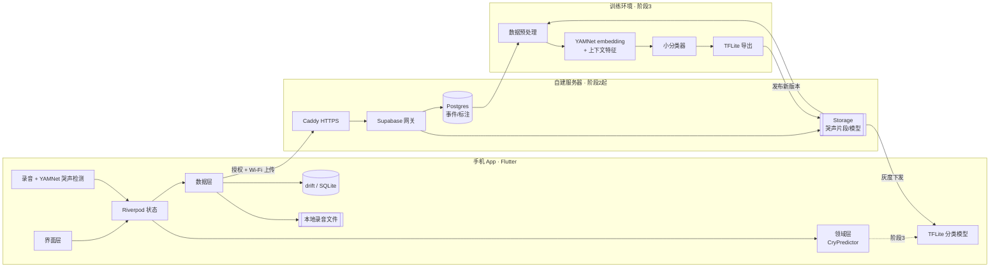
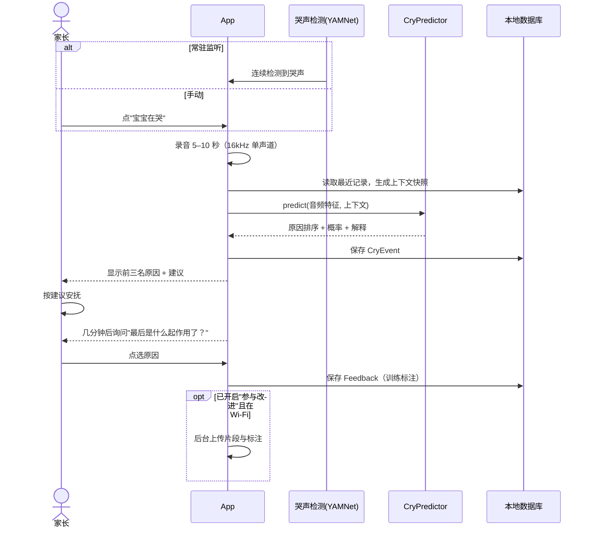
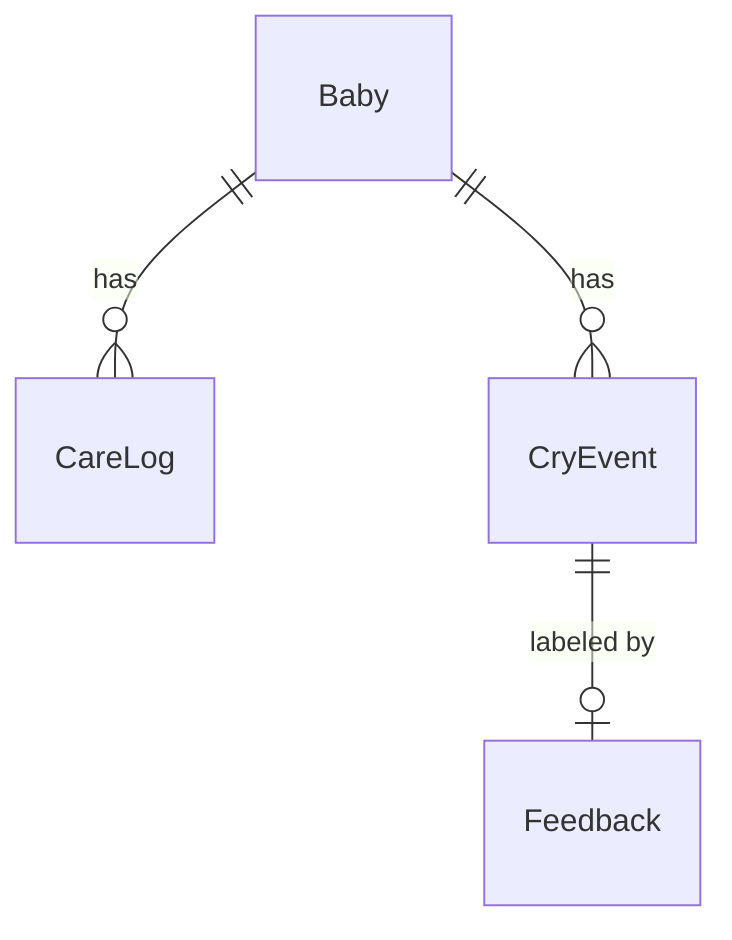
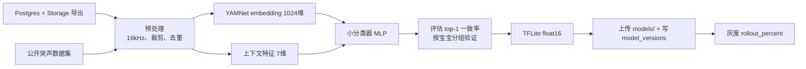

# 哄哄 整体架构

> 版本 v0.1 · 2026-10　｜　所有判断仅供参考，不能替代医生。

## 1. 概述

哄哄帮新手爸妈判断宝宝为什么哭。核心是一个闭环：

**宝宝哭 → App 录音并给出"最可能的三个原因" → 家长按建议安抚 → 反馈"最后是什么起作用了"**

记录（喂奶/睡觉/换尿布/拍嗝）为判断提供上下文，反馈为模型提供标注。架构按三阶段演进，但只增不改：

- 第一阶段：纯本地，规则判断
- 第二阶段：用户授权后上传到自建 Supabase，攒数据
- 第三阶段：训练分类模型，TFLite 端上推理 + 个性化

## 2. 系统全景



## 3. 哭声闭环时序



## 4. App 分层架构

| 层 | 职责 | 目录 |
|---|---|---|
| 表现层 presentation | 页面、组件、主题（含夜间模式） | `lib/features/*/`、`lib/core/theme` |
| 应用层 application | Riverpod Provider/Notifier，编排用例（开始录音、预测、保存反馈） | `lib/features/*/` 内 `*_controller.dart` |
| 领域层 domain | 纯 Dart 模型与 `CryPredictor`，不依赖 Flutter | `lib/domain/` |
| 数据层 data | drift 数据库、仓库、文件存储、同步、导出 | `lib/data/` |
| 服务 services | 录音、YAMNet 检测、模型加载 | `lib/services/` |

依赖方向：表现层 → 应用层 → 领域层 ← 数据层（数据层实现领域层定义的仓库接口）。

## 5. 模块与页面对应

| 设计稿页面 | 模块 | 主要内容 |
|---|---|---|
| 1 首页 | `features/home` | 状态栏（距上次喂奶/已睡多久）、"宝宝在哭"大按钮、四个记录快捷键 |
| 2 录音 | `features/cry` (`RecordingPage`) | 波形、倒计时、自动/手动触发 |
| 3 判断结果 | `features/cry` (`ResultPage`) | 前三原因 + 概率 + 解释 + 安抚建议、免责声明 |
| 4 哄好反馈 | `features/feedback` | 原因单选、用时、"更懂宝宝了"进度 |
| 5 记录详情 | `features/logs` | 喂奶/睡眠/尿布/拍嗝记录的补充与编辑、时间线 |
| 6 夜间模式 | `core/theme` + `features/settings` | 暗红主题、大按钮、自动按时段切换 |
| 7 宝宝规律 | `features/insights` | 闹觉时段、喂奶间隔趋势、猜中率 |
| — 设置 | `features/settings` | 宝宝资料、导出数据、参与改进开关、删除全部数据 |

## 6. 领域模型与数据表（drift）



**Baby**：`id`(uuid) · `nickname` · `birthDate` · `createdAt`

**CareLog**：`id` · `babyId` · `type`(feed|sleep|diaper|burp) · `startedAt` · `endedAt?` · `detail?`(JSON：奶量 ml、左/右/奶瓶、尿/便) · `createdAt`

**CryEvent**：`id` · `babyId` · `startedAt` · `durationMs` · `audioPath?` · `cryConfidence` · `contextJson` · `predictionJson` · `predictorVersion` · `autoTriggered` · `syncState`(local|pending|synced)

**Feedback**：`id` · `cryEventId` · `resolvedCause`(hungry|sleepy|gas|diaper|holdMe|unknown) · `minutesToSoothe?` · `note?` · `createdAt`

**ModelVersion**：`version` · `kind`(detector|classifier) · `localPath` · `sha256` · `active` · `installedAt`

定义见 `app/lib/data/db/tables.dart`。上下文用 JSON 快照而不是外键，是为了保证训练时看到的就是当时判断用的数据。

## 7. CryPredictor

```dart
abstract class CryPredictor {
  String get version;
  Future<Prediction> predict(AudioFeatures audio, CryContext context);
}
```

- 输入 `AudioFeatures`：哭声置信度、YAMNet embedding（阶段 3 使用）
- 输入 `CryContext`：距上次喂奶/睡醒/换尿布/拍嗝的时长、是否在睡、时段、月龄
- 输出 `Prediction`：所有原因按概率降序，附一句给家长看的解释

原因：饿、困、胀气、不舒服/尿布、要抱（`CryCause` 枚举，后续可扩展）。

### 第一阶段规则（`RuleBasedPredictor`）

每个原因 = 基础分 + 加分，乘以个性化先验，再 softmax 归一成概率。

| 原因 | 规则 |
|---|---|
| 饿 | 0.4 + ramp(距上次喂奶 / 按月龄的典型间隔：<1 月 150 分，<3 月 180，<6 月 210，其余 240) |
| 困 | 0.3 + ramp(醒着时长 / 按月龄的清醒窗口：60/90/120/150 分)；夜间 +0.4，傍晚 16–19 点 +0.2 |
| 胀气 | 0.3；喂奶后 60 分钟内 +0.8，且这次喂奶后没拍嗝再 +0.6；3 个月内 +0.3 |
| 不舒服/尿布 | 0.3 + ramp(距上次换尿布 / 180 分) |
| 要抱 | 固定 0.6（兜底） |

`ramp(r) = min(1.5·r², 3)`，没有记录时取 0.5。个性化先验 = 该宝宝历史反馈中各原因的相对频率（平滑后），让规则也能"越用越懂"。

## 8. 音频管线

1. `record` 插件采集 16kHz 单声道 PCM。
2. 常驻监听：每 0.975 秒一帧送入 YAMNet（`tflite_flutter`），取"Baby cry, infant cry"类得分，连续 2 帧 > 0.5 则自动开录。
3. 录 5–10 秒，保存 WAV 到应用私有目录，`audio_waveforms` 显示波形。
4. 计算哭声置信度和（阶段 3）embedding，交给 `CryPredictor`。
5. 上传前按 YAMNet 帧得分裁出仅含哭声的片段。

常驻监听需前台服务通知（Android）/后台音频权限（iOS），默认关闭。

## 9. 第二阶段：同步设计

- 设置中"参与改进"开关，开启时展示说明并记录同意时间；关闭即停止上传，并可一键删除云端数据。
- 匿名登录（Supabase Anonymous Auth）获得设备 ID，不收集手机号、姓名、生日（只传月龄）。
- 后台任务只在 Wi-Fi + 充电/电量充足时上传 `syncState = pending` 的事件：先传片段到 Storage `cry-clips/{device_id}/{event_id}.wav`，再 upsert 事件和反馈；成功后标记 `synced`。以本地 uuid 作主键，重复上传是幂等的。
- 只上传有反馈的事件（无标注的样本价值低）。

### Postgres 表（`backend/supabase/migrations/0001_init.sql`）

`devices` · `babies` · `cry_events` · `feedbacks` · `model_versions`，字段与本地一一对应。

### RLS 要点
- 所有表开启 RLS；`devices/babies/cry_events/feedbacks` 只能读写 `device_id = auth.uid()` 的行。
- `model_versions` 登录设备只读，写入只能用 service_role（训练端）。
- Storage：`cry-clips` 私有，路径第一级必须是自己的 uid；`models` 只读。
- service_role key 只放在服务器和训练机，绝不进 App。

## 10. 第三阶段：模型管线



- 训练代码在 `ml/src/`，本地 CPU 即可，必要时租 GPU。
- 端上：`TfliteCryPredictor` = YAMNet embedding + 上下文 → 分类模型；个性化两种方式：①按宝宝历史反馈调整各原因先验（简单，先做）；②在端上只微调输出层（head）。
- 模型下发：App 启动时调用 `eligible_model('classifier')`，版本更新则下载、校验 sha256、写入 `ModelVersions` 并切换；失败回退到上一版本或规则版。
- 灰度：按设备 id 哈希分桶，对比新旧版本 top-1 一致率再全量。

## 11. 隐私与安全

- 默认所有数据只在本机；上传需主动开启，可随时关闭并删除云端数据。
- "删除全部数据"同时清空数据库和录音文件。
- 导出：打包 SQLite 导出的 JSON + 录音为 zip，通过系统分享面板保存。
- 每个判断页显示"仅供参考，不能替代医生"；出现持续尖叫、发热等情况提示就医，不做疾病判断。
- 服务器：只开 80/443，HTTPS，Postgres 不暴露公网，每日异地备份，密钥不入库。
- 应用商店隐私标签如实填写麦克风用途。

## 12. 目录结构

```
honghong/
├── README.md
├── docs/
│   ├── architecture.md       # 本文
│   ├── tech-plan.md          # 三阶段方案与服务器配置
│   └── design/               # 设计稿
├── app/                      # Flutter
│   ├── pubspec.yaml
│   ├── analysis_options.yaml
│   ├── assets/models/        # yamnet.tflite 等（不入库）
│   └── lib/
│       ├── main.dart
│       ├── core/theme/       # 日间/夜间主题
│       ├── domain/
│       │   ├── models/       # CryCause、CryContext
│       │   └── predictor/    # CryPredictor、RuleBasedPredictor
│       ├── data/db/          # drift 表与数据库
│       ├── services/audio/   # 录音、YAMNet 检测
│       └── features/
│           ├── home/  cry/  feedback/
│           └── logs/  insights/  settings/
├── ml/                       # Python 训练
│   ├── requirements.txt
│   └── src/ data_prep.py features.py train.py export_tflite.py
└── backend/
    ├── README.md             # 自建 Supabase 部署
    └── supabase/migrations/0001_init.sql
```

## 13. 里程碑

| 里程碑 | 内容 | 预估 |
|---|---|---|
| M1 骨架 | 工程初始化、主题、drift 表、宝宝资料 | 1 周 |
| M2 记录 | 首页四个快捷记录、状态栏、记录详情 | 1–2 周 |
| M3 哭声闭环 | 录音、规则预测、结果页、反馈 | 2 周 |
| M4 自用打磨 | 夜间模式、导出、自家宝宝实测（奶爸本人试用） | 2 周 |
| M5 检测 | YAMNet 端上检测、常驻监听自动开录 | 1–2 周 |
| M6 规律 | 宝宝规律页、个性化先验 | 1 周 |
| M7 第二阶段 | 自建 Supabase、参与改进、同步 | 2 周 |
| M8 第三阶段 | 训练、TFLite 接入、模型下发与灰度 | 视数据量 |

## 附：第一阶段实现备注（v1.1 设计稿落地）

- **护理记录计时**：`care_logs.ended_at` 为空表示"进行中"。喂奶/睡觉/拍嗝点一下 `startSession`，点「结束」先 `stopSession` 写结束时间，再弹面板；「继续」调用 `resumeSession` 把结束时间清空，「保存记录」用微调后的时长和细节 `saveSession`。换尿布 `logDiaper` 一点即记（started_at = ended_at），之后 `updateDetail` 改类型。
- **数据库 v2 迁移**：把 v1 的时间点记录（喂奶/拍嗝/换尿布 ended_at 为空）补成已结束；多条未结束睡眠只保留最新一条；新建部分唯一索引 `care_logs_one_active (baby_id, type) WHERE ended_at IS NULL`，保证每类最多一条进行中。
- **细节 JSON**（`care_logs.detail`）：`method`（breast/bottleBreast/formula）、`side`（left/right/both）、`ml`、`note`、`diaper`（unknown/pee/poo/both/dry）。
- **自动监听**：`assets/models/yamnet.tflite`（TF Hub YAMNet 分类版，输入 15600 个 16kHz 采样，输出 521 类），取第 19/20 类（哭泣 / 婴儿哭）得分，3 帧里 2 帧 ≥ 0.35 触发，冷却 60 秒。只在 App 前台时工作。
- **导出**：「我的 → 导出录音和标注」生成 `honghong-export-*.zip`（`data.json` + `recordings/*.wav`），通过系统分享发出。
- **截图测试**：`flutter test --tags golden --run-skipped --update-goldens` 生成 `app/test/goldens/*.png`，用来和 `docs/design/screens-*.png` 对照（CI 默认跳过）。
