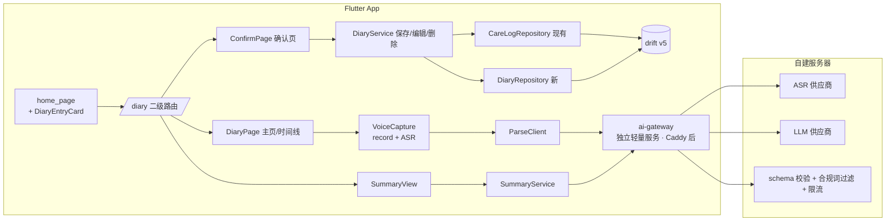
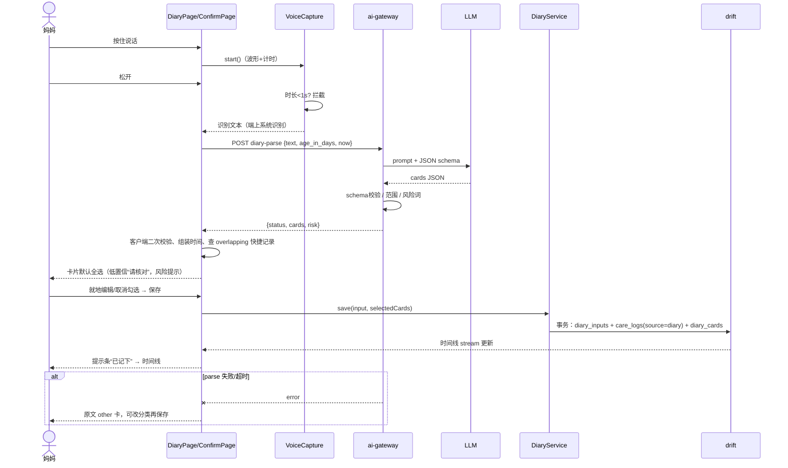
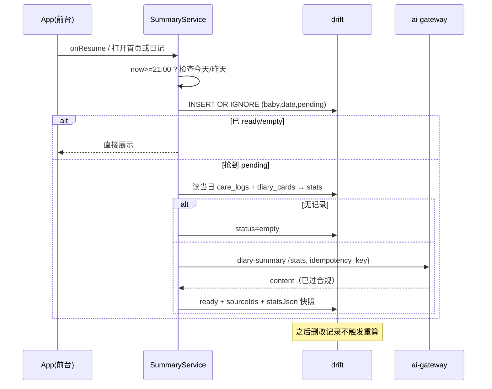

# 哄哄 · 妈咪日记 技术架构方案

> 版本 v1.0 · 2026-10-14 · 状态：定稿（决定 D1–D12 已于 2026-10-14 确认）
> 输入：`/workspace/mommy-diary-prd.md`、`docs/design/mommy-diary/`（已确认设计稿）、现有代码 `app/`、`backend/`。
> 本期不做：推送、多宝宝、早产矫正月龄、离线记录。

## 0. 现状摘要（读代码得出）

| 方面 | 现状 | 对妈咪日记的影响 |
|---|---|---|
| 客户端 | Flutter 3.47 + Riverpod + go_router + drift(SQLite)，本地优先 | 新功能沿用同一栈，新增 `features/diary/` |
| 路由 | `app_router.dart`：TabShell 4 个分支（首页/规律/家庭/我的）+ 若干二级页（`/cry/result/:id`、`/logs`…） | 日记页全部注册为**二级路由**，不碰 TabShell |
| 数据库 | `tables.dart`：Babies(id, nickname, birthDate…)、CareLogs(type=feed/sleep/diaper/burp, startedAt, endedAt, detail JSON, updatedAt, deleted, dirty, updatedBy)、CryEvents、Feedbacks、ModelVersions；`schemaVersion = 4`，`onUpgrade` 逐版本 addColumn | 新增表与字段走 **schema v5** 迁移；Babies 无性别字段 |
| 首页快捷记录 | `home_page.dart` `_QuickGrid` → `CareActions` → `CareLogRepository.add/startSession/stopSession/logDiaper/backfill`，写 CareLogs；软删除 `deleted=true` | 快捷记录已是 CareLogs，日记时间线直接读它 |
| 家庭同步 | `family_sync.dart`：dirty 行推送到 `shared_care_logs`（type check 限 4 类）；`shared_babies` | 日记若把喂奶/睡/尿布写进 CareLogs，随家庭同步给家人（已确认 D3） |
| 云端 | 自建 Supabase（Caddy→Kong），`env.dart` 用 `--dart-define` 注入 URL/anon key，未配置时完全离线；**functions 服务当前在 override 里被禁用** | 需要新开一个服务端 AI 代理，密钥不能进 App |
| AI | 现有“AI”只有端上 YAMNet/TFLite 哭声模型与规则预测，**没有任何 LLM/ASR 调用** | 语音转文字与拆分/小结是全新能力 |
| 录音 | 已依赖 `record: ^7.1.2`，有麦克风权限流程 | 可复用录音；ASR 需新增 |

## 1. 总体设计原则

1. **单一事实来源（SSOT）**：喂奶/睡眠/尿布这类“照护事件”只存在 `care_logs` 一处。日记 AI 卡片中属于这 3 类且是**单次事件**的，确认后直接写入 `care_logs`（`source='diary'`）；首页快捷记录本来就在 `care_logs`。时间线和小结都从 `care_logs` 读，天然不重复计数。
2. 新类别（情绪、其他）与“当日汇总”类表述（“今天吃奶6次”）存在新表 `diary_cards`，**不参与次数统计**，只做展示与小结上下文。
3. AI 只“建议”，不落库；落库只在妈妈点“保存”时发生，且全部本地事务写入。
4. 密钥与模型调用只在服务端；发给 AI 的数据最小化（文本 + 日龄 + 当前时间/时区），不含小名、性别、baby_id。
5. 只增不改：不改现有表语义、不改 TabShell、不改快捷记录流程。

## 2. 模块划分



| 模块 | 位置 | 职责 |
|---|---|---|
| DiaryEntryCard | `features/home/`（新 widget，插在 `_QuickGrid` 与“今天的记录”之间） | 入口卡片；21:00 后显示“今日小结已生成”；夜间模式随时间线隐藏 |
| features/diary/ | 新目录：`diary_page.dart`、`confirm_page.dart`、`card_editor.dart`、`summary_card.dart`、`gender_prompt.dart` | 屏 3–23 |
| VoiceCapture | `services/diary/voice_capture.dart` | 按住说话、波形计时、上滑取消、<1 秒拦截；产出文本 |
| ParseClient | `services/diary/parse_client.dart` | 调 `/diary/parse`，超时、重试、降级 |
| DiaryService | `domain/diary/diary_service.dart` | 卡片→落库映射（care_logs / diary_cards）、事务保存、编辑删除 |
| DiaryRepository | `data/repositories/diary_repository.dart` | diary_inputs / diary_cards / daily_summaries CRUD 与时间线合并查询 |
| SummaryService | `domain/diary/summary_service.dart` | 21:00 后触发、幂等、存储 |
| RiskWords | `domain/diary/risk_words.dart` | 本地风险词表（高烧、抽搐、呼吸困难…），只出通用提示 |
| ai-gateway | `backend/ai-gateway/`（新，独立服务） | parse、summary（本期不含云 ASR）；校验与合规 |

路由新增：`/diary`（主页/时间线，`?date=yyyy-MM-dd`）、`/diary/confirm`（extra 传 ParseResult）、`/diary/text`（文字输入）。均为顶层 GoRoute，无底部标签栏。

## 3. 数据模型（drift schema v5）

### 3.1 Babies 补性别
```dart
TextColumn get gender => text().nullable()(); // 'boy' | 'girl' | null(未填/跳过)
```
- 迁移：`if (from < 5) await m.addColumn(babies, babies.gender);` 老数据为 null，不回填。
- 设计稿屏 3：首次进入日记时若 `gender == null` 弹补问，可跳过；跳过记一个 prefs 标记 `diary_gender_prompted=true`，不再反复问（可在“我的”里改）。
- 性别可跳过，以设计稿为准；PRD 中的“必填”已作废（已确认 D5）。
- 性别**不发给 AI**，本期仅存档；云端 `shared_babies` 加 `gender text null`（迁移 `0004_diary.sql`），同步字段随 `pushBaby` 带上，老版本客户端忽略即可。

### 3.2 CareLogs 增加来源字段
```dart
TextColumn get source => text().withDefault(const Constant('quick'))(); // quick|diary|backfill
TextColumn get diaryCardId => text().nullable()(); // 来自日记时，指向 diary_cards.id
```
- 迁移：addColumn 两列；历史行默认 `quick`。
- `shared_care_logs` 本期不加 `source`（去重靠 SSOT，不依赖该列）。
- 时间线上 `source='quick'` 的显示“快捷记录”标签。

### 3.3 新表
```dart
/// 一次输入（一句话）
class DiaryInputs extends Table {
  TextColumn get id => text()();
  TextColumn get babyId => text().references(Babies, #id)();
  TextColumn get inputType => text()();          // voice|text
  TextColumn get rawText => text()();            // 识别/输入原文（可在确认页修改后重拆）
  IntColumn get ageInDays => integer()();
  TextColumn get parseStatus => text()();        // ok|partial|failed
  TextColumn get promptVersion => text()();      // 例如 parse-v1
  TextColumn get modelVersion => text().nullable()();
  IntColumn get latencyMs => integer().nullable()();
  DateTimeColumn get createdAt => dateTime().withDefault(currentDateAndTime)();
  BoolColumn get deleted => boolean().withDefault(const Constant(false))();
  @override Set<Column> get primaryKey => {id};
}

/// 日记卡片：所有已保存的 AI 卡片都有一行（包括已写入 care_logs 的，作为溯源）
class DiaryCards extends Table {
  TextColumn get id => text()();
  TextColumn get inputId => text().nullable().references(DiaryInputs, #id)();
  TextColumn get babyId => text().references(Babies, #id)();
  TextColumn get category => text()();           // feeding|sleep|diaper|mood|other
  TextColumn get kind => text()();               // event(单次)|aggregate(当日汇总)
  TextColumn get careLogId => text().nullable()(); // kind=event 且 category∈{feeding,sleep,diaper} 时指向 care_logs.id
  DateTimeColumn get eventTime => dateTime().nullable()();
  TextColumn get timePeriod => text().nullable()(); // morning|afternoon|evening|night|all_day
  DateTimeColumn get sortTime => dateTime()();     // 排序用：eventTime ?? 时段默认点 ?? createdAt
  DateTimeColumn get diaryDate => dateTime()();    // 归属日期（本地日 00:00），见 3.5
  TextColumn get attributes => text()();           // JSON，分类专属字段
  TextColumn get intensity => text().nullable()();
  TextColumn get note => text().nullable()();      // 原文片段
  RealColumn get confidence => real().nullable()();
  BoolColumn get editedByUser => boolean().withDefault(const Constant(false))();
  DateTimeColumn get createdAt => dateTime().withDefault(currentDateAndTime)();
  DateTimeColumn get updatedAt => dateTime().nullable()();
  BoolColumn get deleted => boolean().withDefault(const Constant(false))();
  @override Set<Column> get primaryKey => {id};
}

/// 今日小结：每宝宝每日一条
class DailySummaries extends Table {
  TextColumn get id => text()();
  TextColumn get babyId => text().references(Babies, #id)();
  DateTimeColumn get date => dateTime()();        // 本地日 00:00
  TextColumn get status => text()();              // pending|ready|empty|failed
  TextColumn get content => text().nullable()();  // ≤50 字
  TextColumn get sourceIds => text()();           // JSON：care_log ids + diary_card ids（快照）
  TextColumn get statsJson => text()();           // 生成时的统计快照
  TextColumn get promptVersion => text()();
  IntColumn get attempts => integer().withDefault(const Constant(0))();
  DateTimeColumn get generatedAt => dateTime().nullable()();
  @override Set<Column> get primaryKey => {id};
  @override List<Set<Column>> get uniqueKeys => [{babyId, date}];
}
```
- 软删除沿用现有 `deleted` 约定。PRD 的 `deleted_at` 用 `deleted + updatedAt` 表达，保持全库一致。
- 本期 diary_inputs / diary_cards / daily_summaries **只存本地，不同步**（PRD 家人共享不在范围）。

### 3.4 卡片 → 落库映射

| AI 卡片 | 落库 | 是否计入次数 |
|---|---|---|
| feeding / sleep / diaper，kind=event | `care_logs` 新行（source=diary）+ `diary_cards` 溯源行（careLogId 关联） | 是（通过 care_logs） |
| feeding / sleep / diaper，kind=aggregate（“今天吃奶6次”） | 仅 `diary_cards`，attributes.count=6 | 否，单独标“当日汇总” |
| mood / other | 仅 `diary_cards` | 不适用 |

care_logs.detail 映射：feeding.method→`FeedMethod`(亲喂→breast，瓶喂母乳→bottleBreast，奶粉→formula)，`ml`，`side`；duration_min→`endedAt = startedAt + 时长`；diaper.type→`DiaperKind`(pee/poo/both)；sleep start/end→startedAt/endedAt。映射不了的细节（如“性状偏稀”）放 `note`。缺少时间的单次喂奶/尿布用 sortTime 作 startedAt。

**sleep 无结束时间**（“宝宝3点睡了”）：写 care_logs 时 endedAt 必须非空，否则会被首页 `watchActive` 当成正在进行的会话。规则（已确认 D4）：只有开始时间时写成进行中会话（endedAt 为空），与首页“睡觉中”统一，确认卡上明确显示“进行中”；若已有进行中的睡眠则不新开，提示妈妈核对。

### 3.5 归属日期与时段默认点
- `diaryDate` = eventTime 的本地日期；无 eventTime 时取 createdAt 日期。
- 凌晨补记（00:00–04:59 说“昨晚/夜里”）：AI 返回 `day_offset=-1`，客户端据此归到前一天，确认卡上可改日期（已确认 D6）。
- 时段默认点：morning 09:00、afternoon 15:00、evening 19:00、night 23:00（夜里若在凌晨补记则 03:00）、all_day → createdAt。

### 3.6 时间线合并与去重
```sql
-- 某日时间线 = care_logs(未删除, 当日) ∪ diary_cards(未删除, 当日, careLogId IS NULL)
SELECT 'care' src, id, type, started_at sort_time, source FROM care_logs
 WHERE baby_id=? AND deleted=0 AND started_at >= :d0 AND started_at < :d1
UNION ALL
SELECT 'card', id, category, sort_time, 'diary' FROM diary_cards
 WHERE baby_id=? AND deleted=0 AND care_log_id IS NULL AND diary_date = :d0
ORDER BY sort_time;
```
- `careLogId` 非空的 diary_card 不单独出现（它的展示由 care_logs 行负责，点开可看原话），所以同一件事只出现一次。
- 统计次数（入口卡、小结 stats）只数 care_logs；汇总卡单独展示“妈妈说：今天共 6 次”。
- 汇总与实际次数冲突时（汇总 6，care_logs 4）：小结只陈述“记录了 4 次喂奶，妈妈提到全天约 6 次”，不相加（已确认 D2）。
- **重复事件提醒（非自动去重）**：保存日记 event 卡前，用现有 `CareLogRepository.overlapping()` 查同类型 ±15 分钟内的快捷记录，若命中则在确认卡上提示“首页已记过一次，是否还要保存？”并默认取消勾选该卡，不自动合并（已确认 D1）。
- 编辑/删除：时间线上删 care_logs 行（source=diary）时同时软删对应 diary_card；删快捷记录走现有 `delete()`。

## 4. API（ai-gateway）

所有接口：HTTPS，Supabase 匿名登录 JWT（复用 `ensureSignedIn()`），按 auth.uid 限流（如 60 次/天 parse、3 次/天 summary）。服务端不落库用户文本，只记匿名指标（耗时、状态、prompt 版本）。

### 4.1 `POST /diary-asr`（本期不做；仅当端上识别中文口语准确率不达标时再加）
请求：`multipart` 音频（16kHz 单声道 wav/opus，≤60s）。响应：`{ "text": "...", "duration_ms": 4200 }`。音频处理完即丢弃。

### 4.2 `POST /diary-parse`
```json
// 请求
{ "text": "今天吃奶6次，下午哭得厉害", "age_in_days": 102,
  "now": "2026-10-14T20:31:00+08:00", "input_type": "voice", "client_version": "1.4.0" }
// 响应
{ "status": "ok", "prompt_version": "parse-v1", "model": "xxx",
  "cards": [ ...见 5.1 ], "risk": { "hit": false } }
```
`status`：ok / partial（部分卡片校验失败被丢弃并转成 other） / failed。

### 4.3 `POST /diary-summary`
```json
{ "date": "2026-10-14", "age_in_days": 102,
  "stats": { "feed": {"count":4,"total_ml":360,"aggregate_count":6},
             "sleep": {"count":3,"total_min":410}, "diaper": {"count":5,"poo":1},
             "mood": [{"period":"afternoon","type":"哭闹","intensity":"厉害"}],
             "other": ["洗澡"] },
  "idempotency_key": "<summaryId>" }
// 响应
{ "content": "今天宝宝吃了4次奶、睡了约7小时，下午有点闹，妈妈辛苦啦。", "prompt_version": "sum-v1" }
```
客户端先在本地算好 stats，只发聚合数字与短标签，不发原话（数据最小化，也降低模型臆造）。

## 5. AI 流程

### 5.1 拆分输出 schema（JSON Schema，服务端强制 + 客户端二次校验）
```json
{
  "type": "object", "required": ["cards"], "additionalProperties": false,
  "properties": {
    "cards": { "type": "array", "maxItems": 10, "items": {
      "type": "object", "additionalProperties": false,
      "required": ["category", "kind", "note", "confidence"],
      "properties": {
        "category":   { "enum": ["feeding","sleep","diaper","mood","other"] },
        "kind":       { "enum": ["event","aggregate"] },
        "event_time": { "type": ["string","null"], "pattern": "^\\d{2}:\\d{2}$" },
        "end_time":   { "type": ["string","null"], "pattern": "^\\d{2}:\\d{2}$" },
        "day_offset": { "enum": [0, -1], "default": 0 },
        "time_period":{ "enum": ["morning","afternoon","evening","night","all_day", null] },
        "attributes": { "type": "object" },
        "intensity":  { "type": ["string","null"], "maxLength": 20 },
        "note":       { "type": "string", "maxLength": 200 },
        "confidence": { "type": "number", "minimum": 0, "maximum": 1 }
      } } }
  }
}
```
分类 attributes（不认识的键丢弃）：
- feeding：`count:int 1–30`、`method: breast|bottle_breast|formula|null`、`side: left|right|both|null`、`ml:int 1–400`、`duration_min:int 1–180`
- sleep：`duration_min:int 1–960`、`night_wakings:int 0–20`
- diaper：`type: pee|poo|both|null`、`count:int 1–30`、`texture_note:string`
- mood：`type: string(≤10)`（哭闹/开心/烦躁…）
- other：`topic: string(≤10)`（体温/辅食/洗澡/疫苗…）

LLM 侧：使用供应商的结构化输出/JSON mode + 上述 schema；prompt 固定规则（PRD 5.1：不臆造、程度词保留、月龄只用于理解、同类同时段合并、小月龄“吃”=喂奶），时间只让模型输出 `HH:mm` 与 day_offset，由**客户端**结合 `now` 组装成 DateTime（避免模型算错日期/时区）。

### 5.2 校验（服务端一层、客户端一层）
1. JSON 解析 + schema 校验；不合法的单张卡 → 转 `other`，note=原文片段，confidence=0.3，status=partial。
2. 数值范围越界 → 该字段置空（不猜），卡片标“请核对”。
3. 时间合理性：组装后的 eventTime 晚于 now+10 分钟 → 视为前一天或置空；早于 48 小时前 → 置空。
4. **原文覆盖检查**：所有卡片 note 拼起来覆盖不到原文的主要片段时，追加一张 `other` 卡承接剩余文本（满足“不丢弃”）。
5. confidence < 0.6 → UI 显示“请核对”，仍默认勾选。
6. 合规：服务端与客户端各跑一遍风险词（高烧/抽搐/呼吸困难/昏迷…）→ `risk.hit=true`，确认页显示固定文案“如有担心，请及时就医”；输出中出现诊断词（“生病”“不正常”“需要用药”）的 note/intensity 回退为原文片段。

### 5.3 失败兜底

| 环节 | 情况 | 处理 |
|---|---|---|
| 录音 | < 1 秒 | 本地拦截“说长一点试试”，不发请求 |
| 录音 | 上滑取消 | 丢弃音频，不产生任何记录 |
| ASR | 空结果/失败 | 屏 9：底部面板，主按钮“改用文字输入”，可重试 |
| 网络 | 无网/超时 | 文本保留在输入框草稿（prefs），提示重试；本期不做离线排队 |
| parse | 超时（8s）/5xx/schema 全不合法 | 屏 14：原文生成一张 `other` 卡（kind=event），可手动改分类再保存 |
| parse | 部分不合法 | 合法卡正常展示，其余转 other |
| summary | 失败 | status=failed，attempts+1，下次打开 App 再试，最多 3 次；时间线顶部不显示错误，只显示“今晚小结还在整理” |
| 云端未配置 | `cloudConfigured=false` | 入口卡仍显示，进入后语音/拆分不可用提示，文字记录可手动选分类保存（同 other 兜底） |

### 5.4 今日小结：触发、幂等、存储
- **触发（无推送、无后台任务）**：前台触发。条件 = 本地时间 ≥ 21:00 且 当日 `daily_summaries` 不存在或 status∈{pending,failed 且 attempts<3}。触发点：App 进入前台、打开首页、打开日记页。21:00 后首次进入即生成；当天 21:00 后一直没打开，则次日打开时**补生成昨天**（已确认 D7）。生成时间固定 21:00，不提供自定义，`daily_summaries` 不依赖具体时刻以便后续扩展（已确认 D12）。
- **空日**：当日 care_logs + diary_cards 为 0 → 写 status=empty，不调 AI，显示屏 23 温和提示。
- **幂等**：先在事务里 `INSERT OR IGNORE` 一行 (babyId, date, status=pending)，拿到唯一 summaryId；只有把 pending 行抢到手的调用者发请求，`idempotency_key=summaryId`，服务端 24h 内同 key 返回同一结果。并发（首页和日记页同时触发）由 drift 单连接 + unique key 保证只发一次。
- **存储与不改写**：成功写 content、sourceIds、statsJson 快照、generatedAt，status=ready。之后删除/修改/新增记录**不触发重算**，小结保留原文；时间线顶部小结下注“生成于 21:03”。如果用户删了小结里提到的记录，不做任何处理（符合设计稿）。本期不提供手动“重新生成”（已确认 D8）。
- **合规**：服务端输出过滤诊断/恐吓词与 >50 字截断；命中则用模板句兜底（“今天记录了 X 次喂奶、Y 次换尿布，辛苦啦”），模板只用统计数字，绝不虚构。

## 6. 时序图

### 6.1 一句话打卡


### 6.2 今日小结


## 7. 隐私与合规
- 音频：识别后即删，本地和云端都不保留；本期使用端上系统识别（iOS Speech / Android SpeechRecognizer，`speech_to_text` 插件），音频不出机（已确认 D9）。
- 发给云端的只有：文本、日龄、当前时间（含时区）；小结只发聚合统计。不含小名、性别、baby_id、设备信息。
- 服务端不持久化文本；日志只记 hash、耗时、状态。
- 隐私政策需新增：语音识别与大模型第三方、是否出境（已确认 D11：选用国内大模型供应商，数据不出境）。
- 免责声明文案按 PRD 6.3 放在小结区与确认页风险提示。
- “参与改进”现有研究上传**不包含**日记数据；diary_cards.edited_by_user 只本地统计，若要上报准确率需单独同意（后续）。

## 8. 风险

| 风险 | 影响 | 缓解 |
|---|---|---|
| 服务端 functions 目前被禁用（override profiles: disabled），自建机资源有限 | AI 无法上线 | 已确认采用独立轻量服务（Deno/Node）挂在 Caddy 后，不启用 Supabase functions，鉴权校验 Supabase JWT（D10） |
| P90 ≤ 5s：ASR + LLM 串联 | 体验 | 端上系统识别实时转写（松手即有文本），LLM 选低延迟模型、限制输出 token、8s 超时兜底 |
| LLM 时间/日期解析错 | 记录挂错天 | 只让模型给 HH:mm+day_offset，客户端组装并校验 |
| 汇总与单次记录冲突 | 计数混乱/焦虑 | 汇总不计数、分开陈述 |
| 日记写入 care_logs 后被家人同步 | 意外共享 | 已确认同步（与快捷记录同一事实）；情绪/其他卡不同步（D3） |
| sleep 只有开始时间 | 首页出现进行中睡眠 | 按 D4 记为进行中会话，确认页显式展示“进行中” |
| 合规：输出诊断性语言 | 法律/焦虑 | 双层词表 + 模板兜底 + 医学顾问审核词表 |
| 成本与滥用 | 费用 | 匿名 JWT 限流、文本长度上限 500 字 |
| 依赖云端（无离线） | 无网不可用 | 文字草稿保留；离线下期 |
| 设计稿新图标为内联 SVG | 实现差异 | 实现前导出到 `app/assets/icons`（1x/2x/3x） |

## 9. 分期实施步骤

| 阶段 | 内容 | 产出/验收 |
|---|---|---|
| P0 准备（2–3 天） | 国内 LLM 厂商评测（须支持 JSON schema 输出）、合规评估；搭建独立 ai-gateway 服务骨架；导出新图标 | 厂商选定、网关可访问 |
| P1 数据层（2 天） | drift v5：babies.gender、care_logs.source/diaryCardId、3 张新表；`0004_diary.sql`（shared_babies.gender）；DiaryRepository + 时间线合并查询 | 迁移测试（v4→v5 老数据不丢）、去重单测 |
| P2 服务端（3 天） | ai-gateway：diary-parse、diary-summary（diary-asr 本期不做，仅端上识别准确率不达标时再加）、schema 校验、风险词、限流、prompt 版本化；评测集 50–100 句真实口语 | 评测集拆分准确率、P90 延迟报告 |
| P3 客户端主流程（4–5 天） | 入口卡、二级路由、性别补问、按住说话/上滑取消/文字输入、确认页（默认全选、就地编辑、全不选置灰、失败 other、风险提示）、保存事务 | 屏 1–16 对齐设计稿；widget/golden 测试 |
| P4 时间线与编辑（2–3 天） | 合并时间线、快捷记录标签、汇总标注、历史日期切换、编辑（复用 record_editor_sheet）/二次确认删除、空状态 | 屏 17–20；不重复计数测试 |
| P5 今日小结（2 天） | SummaryService 前台触发、幂等、空日、补生成、不改写、夜间样式 | 屏 2、21–23；并发触发只调一次测试 |
| P6 打磨与灰度（2 天） | 埋点（一键保存率、卡片修改率、识别失败率）、隐私政策、免责声明、内测 | 内测版本 |

## 10. 已确认的决定（2026-10-14）

D1–D12 均已由用户确认，全部采用原推荐方案。

| # | 问题 | 状态 | 最终结论 |
|---|---|---|---|
| D1 | 日记事件与首页快捷记录可能重复（±15 分钟同类型） | ✅ 已确认 | 只提示“首页已记过一次”，默认取消勾选该卡；不自动合并或删改 |
| D2 | 当日汇总与单次记录并存的计数 | ✅ 已确认 | 汇总不计入次数，单独标“当日汇总”；小结里分开陈述，不相加、不取最大值 |
| D3 | 日记写入的喂奶/睡眠/尿布是否家庭同步 | ✅ 已确认 | 同步（与快捷记录同一张 care_logs）；情绪/其他卡、原话、小结本期不同步 |
| D4 | 睡眠只说了开始时间 | ✅ 已确认 | 记为进行中会话，首页显示睡觉中，确认卡明确标“进行中” |
| D5 | 性别是否必填 | ✅ 已确认 | 可跳过，以设计稿为准；PRD 中“必填”作废 |
| D6 | 凌晨补记“昨晚”的归属日期 | ✅ 已确认 | 00:00–04:59 说“昨晚/夜里”归前一天，确认卡上可改日期 |
| D7 | 21:00 后一直没打开 App | ✅ 已确认 | 下次打开时补生成昨天的小结 |
| D8 | 是否提供手动“重新生成”小结 | ✅ 已确认 | 本期不提供；已生成小结不自动、不手动改写 |
| D9 | 语音识别方式与音频保留 | ✅ 已确认 | 端上系统识别（`speech_to_text`），音频不出机、不保留；准确率不达标时再评估云端 ASR |
| D10 | AI 网关部署 | ✅ 已确认 | 独立轻量服务（Deno/Node）挂 Caddy 后，不启用 Supabase functions，校验 Supabase JWT |
| D11 | LLM 供应商 | ✅ 已确认 | 国内供应商，数据不出境，须支持 JSON schema 输出；具体厂商在 P0 评测后选定 |
| D12 | 小结时间是否可自定义 | ✅ 已确认 | 本期固定 21:00，不提供设置项 |
