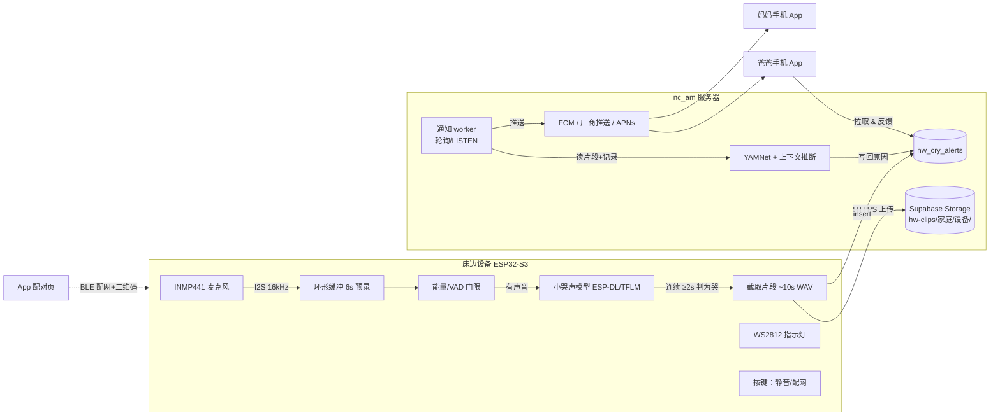

# 哄哄硬件方案：床边哭声监听器

> 版本 0.1（2026-10-14）· 状态：方案稿，未打样
> 价格均为 2026 年网上零售参考价（淘宝/天猫/官方商店，查询于 2026-10），**会波动，仅作估算**；标「估」的是没有查到明确报价、按同类件经验估的。

## 1. 目标与场景

把哄哄最核心的能力——**听到哭声 → 结合喂奶/睡眠/尿布记录猜原因 → 通知家人**——放到一个放在婴儿床边、插电常开的小设备上，手机不必整夜开着 App、放在床边。

典型场景：

| 场景 | 现在（只有 App） | 有设备后 |
|---|---|---|
| 夜里宝宝在婴儿房，大人在隔壁 | 手机得放在婴儿床边并保持 App 前台 | 设备听到哭声，几秒内推送到爸妈手机：「宝宝在哭，可能是饿了（距上次喂奶 3 小时 10 分）」 |
| 白天家里老人带娃，父母上班 | 看不到 | 家庭成员都收到提醒和时间线；谁去哄了一键回「我来」 |
| 午睡监听 | 同上 | 设备灯光轻柔提示，可选播放白噪音安抚（第二阶段） |
| 断网 | — | 设备本地仍检测，灯光提示；恢复后补传 |

非目标（第一版不做）：视频、呼吸/体温等医疗级监测（涉及医疗器械法规）、电池长续航。

## 2. 总体思路

**设备只做「听到哭了」这一件轻活，「为什么哭」交给手机/服务器。**

- 设备（ESP32-S3）：持续在本地分析麦克风（不上传），用一个几十 KB 的小模型判断「是不是婴儿哭」。确认在哭时，把**前后约 10 秒**的录音片段上传到家庭的 Supabase。
- 服务器上的小 worker 或家人手机里的 App：对片段跑 YAMNet 特征 + 现有的上下文推断（和 App 里的 `ModelPredictor` 同一套），生成原因猜测，推送给家庭成员。
- 这样设备便宜、低功耗、固件简单；模型升级主要在 App/服务器侧，不用频繁给设备 OTA。

备选：用能跑完整 YAMNet 的 Linux 小板（Pi Zero 2 W / RK3566），在设备上完成全部推断。成本、功耗、系统维护都更高，留作「离线优先」型号。

## 3. 硬件方案对比

| 方案 | 主控 | 板子参考价 | 能做什么 | 功耗 | 优点 | 缺点 |
|---|---|---|---|---|---|---|
| **A（推荐）** | ESP32-S3（双核 240MHz，向量指令，8MB PSRAM） | DevKitC-1 N16R8 约 ¥22–35（天猫）；模组 ESP32-S3-WROOM-1-N16R8 批量约 $3.2–4.9 | 哭声检测小模型、录片段、Wi-Fi/BLE、OTA | ~0.3–0.5W 常听 | 便宜、成熟、乐鑫有 ESP-SR/ESP-DL、模组自带 SRRC 认证 | 跑不了完整 YAMNet（3.9MB 模型 + 大量运算） |
| A'（更小） | XIAO ESP32S3 **Sense**（自带数字麦克风 + SD 卡槽） | 官方 $13.99（约 ¥100）；预焊版 $14.90 | 同 A | 同 A | 拇指大小，自带麦克风，最快出原型 | 板载麦克风灵敏度一般；量产还是要自己画板 |
| B | Raspberry Pi Zero 2 W（4×A53 1GHz，512MB） | 主板约 ¥100–145（国内渠道，原价货偶有 ¥260+） | 设备上跑完整 YAMNet + 分类，Linux | ~1.5–2.5W | 和 App/Python 代码复用度最高 | 需 SD 卡、系统维护、开机慢、货源价格波动 |
| C | Radxa ZERO 3W（RK3566，1–8GB，Wi-Fi 6） | 2GB 版约 $40–65（约 ¥290–470） | 同 B，余量更大，带 NPU（0.8 TOPS） | ~2–3W | 性能富余 | 更贵、更热，社区小 |

结论：**原型和第一代产品用方案 A**；B/C 作为「全离线」高配或开发调试平台。

## 4. 原型 BOM（方案 A）

| # | 器件 | 型号 | 数量 | 参考价 | 说明 |
|---|---|---|---|---|---|
| 1 | 主控板 | ESP32-S3-DevKitC-1 **N16R8**（16MB Flash / 8MB PSRAM） | 1 | ¥22–35 | 也可用 XIAO ESP32S3 Sense（约 ¥100，省掉 #2） |
| 2 | 数字麦克风 | INMP441 I2S 全向 MEMS 模块 | 1–2 | ¥4–12 | 买 2 个，一个备用；24 位 I2S，SNR 61dB |
| 3 | 状态灯 | WS2812B 单颗或 8 灯环 | 1 | ¥1–8（估） | 隐私指示：录音/上传时亮 |
| 4 | 按键 | 12mm 轻触按键 | 2 | ¥1（估） | 「静音/本地模式」+「配网/恢复出厂」 |
| 5 | 功放（可选） | MAX98357A I2S 3W D 类功放模块 | 1 | ¥8–9（淘宝；DFRobot 版 ¥30） | 白噪音/安抚音，第二阶段 |
| 6 | 喇叭（可选） | 4Ω 3W 28–40mm 小喇叭 | 1 | ¥3–8（估） | 同上 |
| 7 | 供电 | USB-C 5V 2A 电源适配器 + 线 | 1 | ¥15–25（估） | 插电常开；不做电池版 |
| 8 | 外壳 | 3D 打印 PLA/PETG（圆润造型，麦克风开孔+防尘网） | 1 | ¥20–60（估，打印服务） | 小批量后改开模 |
| 9 | 杂项 | 杜邦线、面包板、M2 螺丝、硅胶脚垫 | — | ¥15（估） | |

**原型单套约 ¥70–150**（不含白噪音约 ¥60–120）。建议一次备 3 套（一个放家里实测、一个开发、一个备用）。

接线（DevKitC-1 → INMP441，GPIO 可按需调整）：`SCK→GPIO4，WS→GPIO5，SD→GPIO6，L/R→GND，VDD→3V3，GND→GND`；WS2812 数据 → GPIO48（DevKitC-1 板载 RGB 也在 48，可先直接用板载灯）；按键 → GPIO0（BOOT）/GPIO7。

## 5. 系统架构



数据流：设备只上传「确认是哭」的片段和一条告警记录；推断和推送在服务器 worker 里完成（App 打开时也能对未推断的告警补算，worker 挂了不会丢事件）。

## 6. 固件架构（ESP-IDF v5.x，C/C++）

### 6.1 任务划分

| 任务 | 核心 | 内容 |
|---|---|---|
| `audio_task` | Core 1，高优先级 | I2S DMA 读取 16kHz/32 位，右移转 16 位，写入 PSRAM 环形缓冲（预录 6s + 最长 20s） |
| `detect_task` | Core 1 | 每 0.5s 算一次能量；超过噪声底 +12dB 才跑模型（省电、减少误报）；模型输出平滑，连续 4 个窗（约 2s）> 阈值判为「在哭」 |
| `net_task` | Core 0 | Wi-Fi、Supabase 登录/刷新、上传队列（断网时最多存 5 段到 Flash，恢复后补传）、心跳 |
| `ui_task` | Core 0 | LED 状态机、按键（短按静音 30 分钟、长按 5s 进入配网、长按 15s 恢复出厂） |
| `ota_task` | Core 0 | 每天查一次版本，双分区 OTA + 签名校验，失败自动回滚 |

### 6.2 哭声检测模型（设备上的小模型）

- 任务：二分类「婴儿哭 / 其他」（不是猜原因），窗长 1s、步长 0.5s。
- 特征：40 维 log-mel（25ms 窗、10ms 步长）→ 输入 98×40。ESP-DL / ESP-SR 自带 MFCC/mel 前端，也可以用 TFLM 的 `audio_frontend` 微特征。
- 网络：DS-CNN 小型（约 20–60K 参数，INT8 后 < 100KB），在 S3 上单窗推理预计 10–30ms（估，需实测）。
- 训练数据（都在现有 `ml/` 流程里加一个任务）：
  - 正例：donateacry、ESC-50 的 crying_baby、AudioSet 的 Baby cry 片段；以及**我们自己 App 里用户同意参与改进的录音**（`cry_events` 里有片段的）。
  - 负例：ESC-50/AudioSet 的家庭环境声（说话、电视、狗叫、吸尘器、白噪音机、空调、咳嗽、笑声），**重点加白噪音和成人说话**，这是夜里最常见的误报来源。
  - 增强：混入不同 SNR 的背景噪声、增益 ±12dB、房间混响、INMP441 实录的底噪。
  - 也可以用 YAMNet 的「哭声得分」给海量无标签家庭录音打伪标签，再蒸馏到小模型。
- 量化：TensorFlow → `TFLiteConverter` 全 INT8 量化（代表性数据集 300 段）→ ESP-DL 用 `esp-ppq` 转换，或直接 TFLM 跑 `.tflite`。CI 里加一个检查：INT8 模型和浮点模型在验证集上的召回率相差 < 2 个百分点。
- 指标（上线门槛，在**按家庭/录音分组**的验证集上）：哭声召回 ≥ 95%（漏报比误报更糟），误报 ≤ 每晚 1 次（用 8 小时真实夜间录音回放测）。
- 阈值可由服务器下发（设备配置），不用为调阈值做 OTA。

### 6.3 片段与上传

- 预录：判定为哭时，片段 = 触发前 4s + 之后 6s（可配置），16kHz/16 位单声道 WAV，约 320KB；也可以用 IMA-ADPCM 压到约 80KB。
- 同一次哭在 2 分钟内只告警一次（之后只更新「还在哭」的时长）。
- 上传：HTTPS（mbedTLS，内置服务器 CA 证书），先传 Storage，再插入 `hw_cry_alerts`；失败指数退避重试。

### 6.4 配网与开通

- 首选 **BLE 配网**（ESP-IDF `wifi_provisioning`，security 2 / SRP6a，配对口令是二维码里的 PoP）。App 扫设备底部二维码 → BLE 发送 Wi-Fi 名称/密码 + 一次性配对令牌。
- 后备：SoftAP 配网（设备开热点 `Honghong-XXXX`，手机连上后网页填写）。
- 只支持 2.4GHz Wi-Fi（ESP32-S3 限制），App 里要提示。

### 6.5 功耗与散热

- 插电常开，不做深度睡眠；Wi-Fi 用 modem sleep（DTIM 3），平均约 0.3–0.5W（估），全年电费可忽略。
- 主频 160MHz 足够；外壳留通风孔，元件表面温度目标 < 45°C（放在婴儿床边，必须摸着不烫）。
- 电源线：设备放在婴儿够不到的地方（≥1m），线长和固定方式写进说明书（防勒绕）。

## 7. 设备身份与安全

原则：**设备上永远没有 service_role key**；设备和手机一样，是 Supabase 里一个受 RLS 限制的普通登录身份，只能写自己家庭的告警和片段。

### 7.1 身份与配对流程

1. 出厂：每台设备在 NVS（开启 Flash 加密）里写入 `device_serial` 和随机 `pair_secret`（32 字节）；底部贴二维码：`honghong://pair?s=<serial>&p=<pop>`。工厂只记录 `serial`，不记录 secret 明文（服务器存哈希）。
2. App 里「添加设备」→ 扫码 → 调用 RPC `hw_start_pairing(serial)`：校验调用者是某家庭的 owner，生成 10 分钟有效的一次性 `pair_token`（服务器只存哈希）。
3. App 通过 BLE 把 Wi-Fi 信息 + `pair_token` 发给设备。
4. 设备连网后匿名登录 Supabase（和手机一样 `signInAnonymously`，拿到自己的 `auth.uid()` 与 refresh token，存在加密 NVS），调用 RPC `hw_claim(pair_token, serial)` → 服务器把这个 uid 绑定为该家庭的设备。
5. 之后设备用 refresh token 维持登录；**解绑**＝ owner 在 App 里删除设备（服务器删除绑定、吊销该 uid 的会话），设备下次请求失败后回到待配网状态。

每台设备一个独立身份，泄露只影响一台，可单独吊销。

### 7.2 数据库草案（迁移 `0004_hardware.sql`，未执行）

```sql
-- 家庭里的床边设备
create table public.hw_devices (
  id uuid primary key,                          -- = 设备的 auth.uid()
  family_id uuid not null references public.families(id) on delete cascade,
  serial text not null unique,
  name text not null default '床边监听器' check (char_length(name) <= 16),
  fw_version text,
  config jsonb not null default '{}',           -- 阈值、静音时段等，由 App 修改、设备读取
  last_seen_at timestamptz,
  rssi int,
  created_at timestamptz not null default now()
);

create table public.hw_pairings (
  token_hash text primary key,                  -- sha256(pair_token)
  family_id uuid not null references public.families(id) on delete cascade,
  serial text not null,
  created_by uuid not null default auth.uid(),
  expires_at timestamptz not null default now() + interval '10 minutes'
);

-- 设备告警：设备写入，worker/App 补充推断结果
create table public.hw_cry_alerts (
  id uuid primary key default gen_random_uuid(),
  family_id uuid not null references public.families(id) on delete cascade,
  device_id uuid not null references public.hw_devices(id) on delete cascade,
  started_at timestamptz not null,
  duration_ms int not null,
  detector_score real not null,
  clip_path text,                               -- hw-clips/{family_id}/{device_id}/{id}.wav
  status text not null default 'new' check (status in ('new','analyzed','notified','handled')),
  prediction jsonb,                             -- 与 shared_cry_events.prediction_json 同结构
  handled_by uuid,
  created_at timestamptz not null default now()
);
create index on public.hw_cry_alerts (family_id, created_at desc);

alter table public.hw_devices enable row level security;
alter table public.hw_pairings enable row level security;
alter table public.hw_cry_alerts enable row level security;

-- 家庭成员可以看设备和告警；设备只能看/改自己
create policy hwd_family on public.hw_devices for select to authenticated
  using (public.is_family_member(family_id) or id = auth.uid());
create policy hwd_self_update on public.hw_devices for update to authenticated
  using (id = auth.uid()) with check (id = auth.uid());   -- 心跳、固件版本（family_id 用触发器禁止修改）
create policy hwa_read on public.hw_cry_alerts for select to authenticated
  using (public.is_family_member(family_id));
create policy hwa_device_insert on public.hw_cry_alerts for insert to authenticated
  with check (device_id = auth.uid()
              and family_id = (select family_id from public.hw_devices where id = auth.uid()));
create policy hwa_member_update on public.hw_cry_alerts for update to authenticated
  using (public.is_family_member(family_id));             -- 标记"我来了"、补推断
-- hw_pairings 不开放直接读写，只通过 security definer 的 hw_start_pairing / hw_claim 访问

insert into storage.buckets (id, name, public) values ('hw-clips','hw-clips',false);
create policy hwclips_device_write on storage.objects for insert to authenticated
  with check (bucket_id = 'hw-clips'
              and (storage.foldername(name))[2] = auth.uid()::text
              and (storage.foldername(name))[1] = (select family_id::text from public.hw_devices where id = auth.uid()));
create policy hwclips_family_read on storage.objects for select to authenticated
  using (bucket_id = 'hw-clips' and public.is_family_member(((storage.foldername(name))[1])::uuid));
```

还需要：`hw_start_pairing` / `hw_claim` / `hw_unpair` 三个 security definer 函数；片段 7 天自动清理（cron 或 worker 定时删）；每台设备每小时告警数上限（防止坏设备刷库）。

### 7.3 推送（当前 nc_am 上 Realtime 和 Edge Functions 都是关闭的）

方案：在 nc_am 上加一个**独立的小容器** `honghong-notifier`（Deno 或 Python，约 200 行），不动现有服务和 OpenResty：

- 用数据库连接 `LISTEN hw_alert`（告警表加 `pg_notify` 触发器），没有 LISTEN 也可以每 5 秒轮询 `status='new'`。
- 收到告警 → 下载片段 → 跑 YAMNet 嵌入 + `cry_head` + 规则（复用 `ml/src/features.py` 和同一份模型，保证与 App 一致）→ 写回 `prediction`，状态改为 `analyzed`。
- 推送：
  - Android：**FCM**（海外/有 GMS 的手机可用）；国内手机 FCM 基本不可达，需要接 **厂商推送**（华为/小米/OPPO/vivo/荣耀）或聚合 SDK（个推、极光 JPush），这是国内 Android 后台通知唯一可靠的路。
  - iOS：APNs（需要 Apple 开发者账号）。
  - 兜底：App 已有的家庭同步在打开 App 时拉取告警；Android 可选「夜间守护」前台服务轮询（耗电，作为可选项）。
- 需要新增 `push_tokens(user_id, platform, token)` 表，App 登录后上报。
- 这个容器用 service_role 访问数据库，**key 只在服务器上**（放在 store secrets 和容器环境变量里，不进仓库）。

## 8. App 需要的改动

| 页面/功能 | 内容 |
|---|---|
| 设置 → 床边设备 | 设备列表（在线状态、最后在线时间、信号、固件版本），添加/改名/删除 |
| 添加设备向导 | 扫码 → 申请蓝牙/定位权限 → 选 Wi-Fi（提示仅 2.4GHz）→ BLE 发送 → 等待设备上线（显示进度和常见问题）。手绘风插画，沿用设计稿风格 |
| 设备设置 | 灵敏度（三档）、夜间静音时段、是否上传录音（关闭时只发「在哭」不发片段）、LED 亮度、白噪音 |
| 告警通知 | 「宝宝在哭 · 可能是饿了」，点开进入结果页（复用现有结果页 + 反馈）；按钮「我来」通知其他家人已有人处理 |
| 首页/时间线 | 设备检测到的哭声和 App 录的哭声合并显示，标注来源（📟设备 / 📱手机）；反馈同样进入个性化 |
| 推断 | App 打开时对 `status='new'` 的告警补算（worker 不在线时） |
| 推送令牌 | 上报 FCM/厂商/APNs token |

## 9. 隐私

- **不连续上传**：音频只在设备内存里滚动，只有判定为哭时才上传那 10 秒。
- **看得见**：上传时 LED 亮暖色；静音模式 LED 熄灭/显示红点。App 里能看到每一段上传了什么、能逐条删除。
- **本地模式**：关闭「上传录音」后，设备只发送「在哭（时间、时长、得分）」，不发任何音频；推断只用记录（和 App 无录音时一样）。
- **硬件静音**：按键一键静音 30 分钟（以后可以加物理麦克风断开开关）。
- 片段默认 7 天后自动删除；参与改进（用于训练）需要单独同意，和现在 App 的规则一致。
- 数据只在用户自己的 Supabase（nc_am），不经过第三方云；推送内容只含文字，不含音频。

## 10. 路线图

| 阶段 | 内容 | 产出/里程碑 | 工作量（1 人，估） |
|---|---|---|---|
| P0 原型（2–3 周） | 买件、面包板接线；ESP-IDF 录音 + 能量门限 + 先用 ESP-SR/规则代替模型；片段手动上传 | 设备能录到清晰的哭声片段，测量底噪和距离 | 1–1.5 周开发 + 1 周实测 |
| P1 检测模型（2–3 周） | 训练 DS-CNN 小模型、INT8 量化、上板；夜间回放测试误报 | 召回 ≥95%，误报 ≤1 次/夜 | 2–3 周 |
| P2 打通云端（2 周） | 0004 迁移、配对 RPC、BLE 配网、上传、notifier 容器、App 设备页 | 扫码 5 分钟内配好；哭 10 秒内手机收到通知（有推送通道时） | 2 周 |
| P3 家用试用（4 周） | 3 套原型在 2–3 个家庭试用；OTA；记录误报/漏报 | 试用报告、改进清单 | 1 周开发 + 3 周观察 |
| P4 产品化（6–10 周） | 自画 PCB（WROOM-1 模组 + 麦克风 + LED + USB-C）、外壳设计开模、小批量 50–200 台、认证 | 可交付的小批量产品 | 视外包情况 |
| P5（可选） | 白噪音/安抚音、方案 B 离线高配、温湿度传感器 | — | — |

## 11. 风险

| 风险 | 影响 | 应对 |
|---|---|---|
| 误报（电视、说话、白噪音机、宠物） | 夜里被吵醒，用户关掉设备 | 负例数据重点覆盖；连续 2s 判定；灵敏度可调；用户「不是哭」反馈回流训练 |
| 漏报（哭声小、距离远、隔着床围） | 失去信任 | 召回优先的阈值；安装指导（距宝宝 0.5–1.5m）；设备自检提示音量过低 |
| 国内 Android 推送不可达 | 收不到告警 | 接厂商推送/聚合 SDK；前台服务兜底；设备本地 LED/提示音 |
| Wi-Fi 不稳 / 只支持 2.4GHz | 配网失败 | 清晰提示；SoftAP 后备；断网本地缓存补传 |
| 服务器（nc_am）宕机 | 不推送 | 设备本地提示；App 打开补算；监控告警 |
| 婴儿安全（线缆、发热、小零件） | 严重 | 放置距离要求、线缆固定、外壳无小零件可拆、温度测试；不宣称医疗用途 |
| 隐私顾虑 | 不愿用 | 第 9 节设计 + 清晰说明 |
| 推断准确率（现阶段音频模型接近随机，靠上下文规则） | 「原因」不准 | 设备的价值首先是「及时知道在哭」；原因随数据积累再提升，界面上保持「仅供参考」 |

## 12. 小批量成本与认证

### 12.1 单台物料成本（100 台，估）

| 项 | 估价 |
|---|---|
| ESP32-S3-WROOM-1-N16R8 模组（批量约 $3.4–3.8） | ¥25–28 |
| 数字麦克风（贴片 INMP441 或国产同类 MEMS） | ¥3–6 |
| WS2812B、按键、USB-C 座、LDO、ESD、被动件 | ¥8–12 |
| PCB + SMT 贴片（嘉立创等，小批量摊销） | ¥15–30 |
| 外壳（小批量手板/软模 ¥30–60；开钢模约 ¥1–3 万一次性，千台后每台 ¥5–10） | ¥30–60 |
| 包装、说明书、USB-C 线（不含适配器） | ¥8–15 |
| 可选：MAX98357A 方案 + 喇叭 | +¥10–15 |
| **合计** | **约 ¥90–150 / 台**（不含认证、开模、人工） |

### 12.2 认证（中国大陆销售前要搞清楚，以下为常见要求，具体以检测机构意见为准）

- **SRRC 型号核准**（无线电发射设备）：选用**已取得 SRRC 的模组**（乐鑫 WROOM 系列模组有）可以大幅简化，但整机通常仍需按要求办理或确认模组证书可用；预计数千到一两万元、1–2 个月。
- **CCC**：不带电源适配器、只用 USB 5V 供电的小设备，多数情况不在 CCC 目录内；**如果随机附带电源适配器，适配器必须有 CCC**（直接采购已认证的适配器即可）。
- **无线电/电磁兼容、电气安全自检报告**（GB 4943.1 信息技术设备安全、EMC），电商平台上架常要求。
- **儿童/婴幼儿相关**：不宣称医疗/监护功能，避免落入医疗器械（二类）监管；外观材料符合 RoHS，外壳选阻燃料（UL94 V-0/V-1）。
- 海外：FCC/CE 模组也有现成认证，整机仍需测试。
- 小批量仅自用/亲友试用（非销售）时一般不需要认证，但安全设计要按产品标准做。

## 13. 下一步（建议立刻可做）

1. 下单 3 套原型件（DevKitC-1 N16R8 ×3、INMP441 ×4、WS2812 ×3、按键、USB-C 电源），或 XIAO ESP32S3 Sense ×2 先行。
2. 在 `ml/` 加一个 `train_detector.py`：用现有数据管线训练二分类 DS-CNN + INT8 导出，先在电脑上用夜间录音回放评估。
3. 新建 `firmware/` 目录（ESP-IDF 工程骨架 + GitHub Actions 用 `espressif/esp-idf-ci-action` 编译）。
4. 写 `0004_hardware.sql` 并在测试库验证 RLS（设备只能写自家告警、其他家庭看不到）。
5. 确定推送通道（先 FCM + 一家厂商推送试点）。

## 参考链接（已打开核实）

- Seeed XIAO ESP32S3 Sense（官方商店，$13.99）：https://www.seeedstudio.com/XIAO-ESP32S3-Sense-p-5639.html
- Radxa ZERO 3W（Arace 官方渠道，$39.99 起）：https://arace.tech/products/radxa-zero-3w
- 乐鑫 ESP32-S3-WROOM-1 模组批量报价（Chipmall）：https://zh.chipmall.com/products/detail/wifi-modules_espressif-systems-esp32-s3-wroom-1-n16r8_c89812392

国内电商（淘宝/天猫）链接时效短、多为导购页，未列出；按型号搜索「ESP32-S3-DevKitC-1 N16R8」「INMP441」「MAX98357A」即可。
